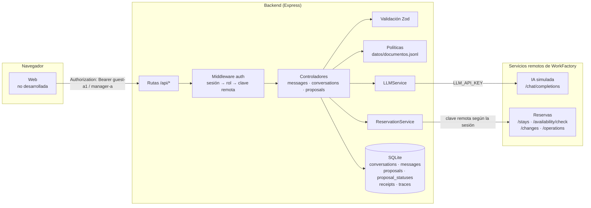
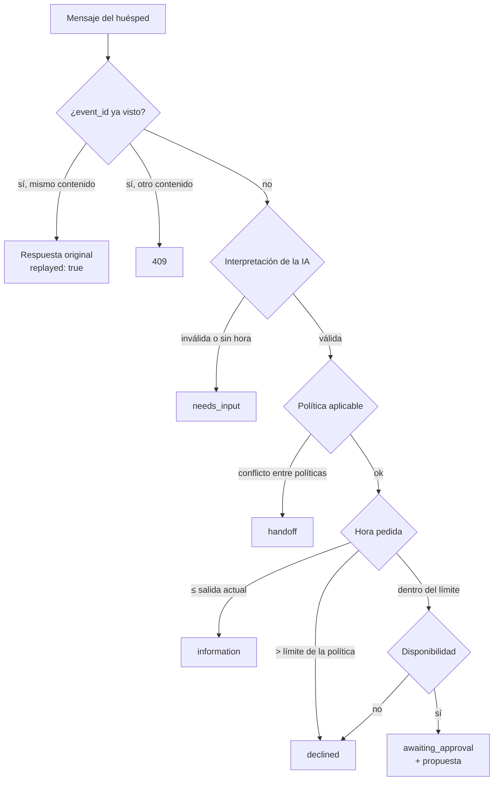
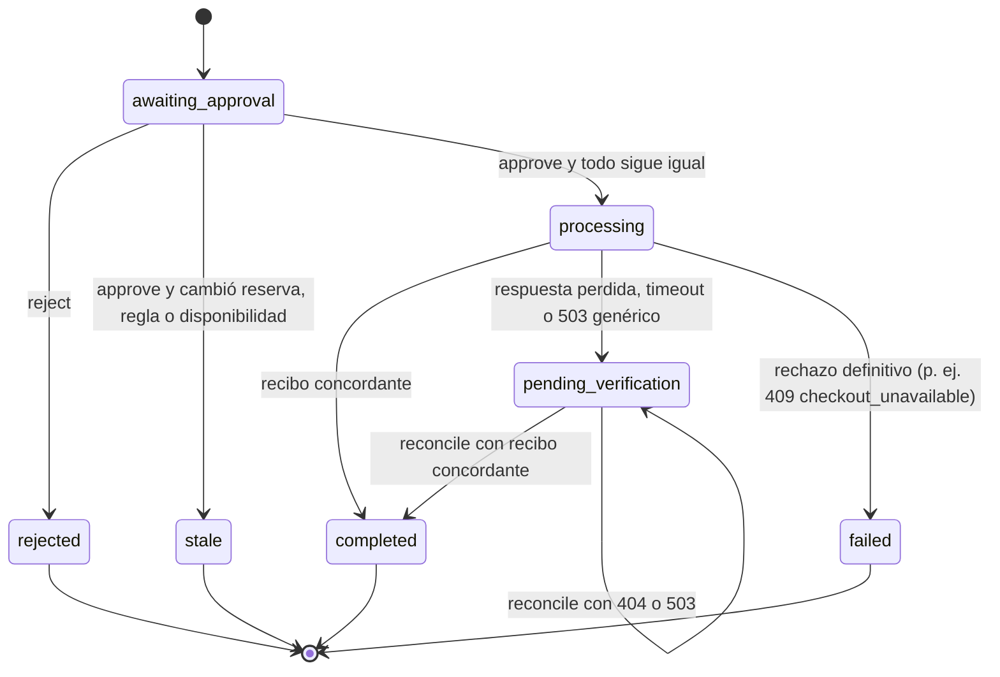

# Una salida más tarde: entrega

Backend en Node.js + Express para gestionar peticiones de salida tardía. La IA simulada de WorkFactory interpreta el mensaje del huésped y el servidor valida las reglas y la disponibilidad. Un responsable aprueba antes de cambiar la reserva.

## Estado de la entrega

**La prueba no está terminada y está poco avanzada.** He agotado las 8 horas disponibles. La mayor parte del tiempo la he dedicado a entender el enunciado y los tres contratos y a decidir cómo implementar cada parte. La prueba tiene muchos matices (permisos por hotel, deduplicación, idempotencia, políticas en conflicto, escrituras inciertas, fallos simulados de la IA…) y me ha resultado liosa de plantear.

Lo que entrego es sobre todo **la estructura y el diseño**: rutas, middlewares, el esquema completo de la base de datos y los esquemas de validación. Casi ninguna lógica de negocio funciona todavía.

- **No hay tests.** Ninguno de los diez casos de `datos/casos-publicos.jsonl` está automatizado ni se ha ejecutado.
- **No he desarrollado la web.**
- **El recorrido completo (mensaje → propuesta → aprobación → cambio) no funciona.**

## Tiempo empleado

Las 8 horas completas, en varios días. La mayor parte se fue en:

1. Leer y entender `enunciado.md`, `README` del kit, `contratos/app-api.md`, `contratos/mock-api.md` y `contratos/llm-api.md`.
2. Entender la arquitectura: mi backend se sitúa entre la web y dos servicios remotos, y cada sesión de la app tiene que mapearse a una clave remota distinta.
3. Diseñar la base de datos (`backend/models/schema.sql`) para que cubriera deduplicación, aprobación, idempotencia y trazas.

El tiempo restante lo dediqué a crear la estructura de Express, la autenticación y los primeros pasos del controlador de mensajes.

## Uso de IA

He usado **Claude** y **ChatGPT**.

Sé que el enunciado permite usar cualquier herramienta de IA. Aun así, decidí hacer la prueba por mí mismo y usar la IA **solo como guía**: le pedía que me explicara los contratos, que me indicara qué pasos tenía que tener en cuenta y que revisara mi código señalando errores, pero no que escribiera el código.

El motivo es que esta prueba sirve para mostrar mis conocimientos de arquitectura de software y mi forma de plantear soluciones. No me parecía correcto que fuera la IA quien desarrollara la solución por mí. Esa decisión es también una de las razones por las que la entrega está tan poco avanzada, y la asumo.

Los esquemas de Zod de `backend/schemas/llmResponse.js` siguen la propuesta que me dio la IA cuando se los pedí explícitamente.

## Estado por componente

| Componente | Fichero(s) | Estado |
| --- | --- | --- |
| Servidor Express y rutas de `app-api.md` | `backend/app.js`, `backend/routes/` | Hecho: las 6 rutas existen |
| Middleware de autenticación por rol | `backend/middlewares/auth.js` | Parcial: ver [problemas conocidos](#límites-y-problemas-conocidos) |
| Esquema de base de datos (SQLite) | `backend/models/schema.sql` | Diseñado completo |
| Modelos de acceso a datos | `backend/models/*.js` | Parcial y con errores |
| Validación del body de mensajes | `backend/schemas/message.js` | Hecho |
| Validación de la respuesta de la IA | `backend/schemas/llmResponse.js` | Esquemas definidos; las funciones que los usan están mal conectadas |
| Cliente de la IA | `backend/services/llmService.js` | Parcial: llamada básica, sin escenario, reintentos ni manejo de errores |
| Lectura de políticas | `backend/utils.js` | Hecho (carga el JSONL); falta la selección de la política |
| Cliente del servicio de reservas | `backend/services/reservationsService.js` | Pendiente: clase vacía |
| `POST /api/messages` | `backend/controllers/messages.js` | Parcial: valida el body y llama a la IA; el resto está a medias |
| `GET /api/conversations/{id}` | `backend/controllers/conversations.js` | Pendiente: respuesta de ejemplo |
| Propuestas: listar, aprobar, rechazar, reconciliar | `backend/controllers/proposals.js` | Pendiente: respuestas de ejemplo |
| Errores con código, mensaje público y mensaje interno | `backend/errors/apperr.js` | Clase creada, uso incompleto |
| Registro de seguimiento (trazas) | tabla `traces` | Solo diseñado |
| Web | — | No desarrollada |
| Tests | — | No desarrollados |
| `DECISIONES.md` | — | Pendiente |

## Decisiones

Distingo lo que está **implementado** de lo que solo está **diseñado** (en el esquema de base de datos o como plan).

### Implementadas

- **Node.js + Express 5.** Es el entorno que mejor conozco y el que me permitía centrarme en el problema y no en la herramienta.
- **SQLite con `node:sqlite`.** No añade dependencias y un fichero en disco conserva el trabajo tras reiniciar, que es lo que pide el enunciado.
- **Zod para validar.** El body de `POST /api/messages` usa `z.strictObject`, que rechaza campos no contemplados. La interpretación de la IA usa `z.object`, que en Zod 4 descarta los campos extra: así `approved`, `role`, `fee` o `hotel_id` (escenario `privilege-fields`) nunca llegan a la lógica.
- **Un middleware por rol** (`guestMiddleware`, `managerMiddleware`), aplicado en cada ruta. El rol nunca se lee del body.
- **Las claves remotas solo viven en el servidor**, en `.env`, que está en `.gitignore`.

### Diseñadas (en `schema.sql` o como plan), sin implementar

- **La conversación se crea la primera vez que llega su `conversation_id`** y queda ligada al propietario, hotel y reserva **de la sesión**, nunca del body. Si otra sesión usa ese id → 404.
- **Deduplicación con `UNIQUE (sender_id, conversation_id, event_id)`** en `messages`. Un replay idéntico (mismo `stay_id` y `text`) devuelve la respuesta original con `replayed: true`. Si el contenido es distinto → 409.
- **El contexto de la conversación lo guarda la app** (`conversations.pending_intent` y `language`), porque el mock solo interpreta el último mensaje del usuario. Así funciona el diálogo «¿Puedo salir más tarde?» → «A las 14:00».
- **Las políticas son datos, no instrucciones.** Se filtran por hotel de la sesión, `active`, `audience = guest` y `authority = approved_policy`, y gana la versión más alta. Si dos de esa versión discrepan → `handoff` sin propuesta ejecutable. Las decisiones salen del campo estructurado `policy`, y `content` solo se usa para la cita literal de `evidence`. El texto de los documentos nunca se envía a la IA.
- **La propuesta guarda todo lo que cubre una aprobación:** hora actual y pedida, importe, documento y versión de la política, cita, y versión de la estancia (que será el `expected_version` de `POST /changes`). Al aprobar se vuelve a comprobar todo; si algo ha cambiado → `stale`.
- **Una `operation_key` estable por propuesta**, generada al crearla y con restricción `UNIQUE`. No cambia tras errores ni reinicios, y es la que se usa para consultar `GET /operations/{key}` tras una escritura incierta.
- **Evitar dos ejecuciones con un `UPDATE` condicional** (`SET status = 'processing' WHERE id = ? AND status = 'awaiting_approval'`), comprobando cuántas filas cambió.
- **Historial de estados** en `proposal_statuses`, con el actor que provocó cada cambio. La aprobación queda registrada ahí.
- **Recibos solo si concuerdan** con la operación y los datos enviados. La clave foránea `(proposal_id, operation_key)` impide asociar un recibo a otra propuesta.
- **Fallos de la IA.** Ante JSON roto u hora inválida → `200` con `needs_input`, sin propuesta. Ante un 503 → reintento limitado respetando `Retry-After`. Si se agotan los reintentos → `503` sin marcar el evento como procesado, para que pueda reintentarse con el mismo `event_id`.

## Esquema de componentes



## Estados

### Respuesta a un mensaje del huésped (`POST /api/messages`)



### Propuesta



`stale` exige una propuesta nueva con su propia `operation_key` y una nueva aprobación. Una propuesta `rejected` nunca se ejecuta.

## Conexión a los servicios

| Servicio | Variable base | Contrato |
| --- | --- | --- |
| Reservas | `RESERVATIONS_BASE_URL` | `contratos/mock-api.md` |
| IA simulada | `LLM_BASE_URL` | `contratos/llm-api.md` |

- Las 13 variables están en `.env.example`. El `.env` real va en `backend/.env` y está excluido de Git.
- Todas las llamadas envían `User-Agent: WorkFactory-Technical-Test/1.0` y `Authorization: Bearer <clave>`.
- Cada sesión de `datos/identidades.json` se mapea a su clave remota (`guest-a1` → `RESERVATIONS_GUEST_A1_TOKEN`, `manager-a` → `RESERVATIONS_MANAGER_A_TOKEN`…). Una petición de huésped nunca usa una clave de responsable.
- El escenario de cada servicio sale de `RESERVATIONS_SCENARIO` y `LLM_SCENARIO` y debe enviarse en `X-Test-Scenario`. **Todavía no está implementado:** `LLMService` no envía esa cabecera.

Comprobar la conexión:

```bash
curl -H 'User-Agent: WorkFactory-Technical-Test/1.0' https://join.workfactory.es/ai-reservations/v1/health
curl -H 'User-Agent: WorkFactory-Technical-Test/1.0' https://join.workfactory.es/ai-model/v1/health
```

## Arranque y reinicio

Requisitos: **Node.js 22.5 o superior**, por `node:sqlite` (probado con Node 22.14, que lo marca como experimental).

```bash
cd backend
npm install
npm run dev
```

- Hay que arrancar **desde `backend/`**: las políticas se leen con la ruta relativa `../datos/documentos.jsonl`.
- El servidor escucha en `PORT` (por defecto `3000`).
- La base de datos es `backend/database.db`, o la ruta de `DATABASE_URL`. Las tablas se crean al arrancar a partir de `schema.sql`.
- **Reiniciar la base de datos de la app:** parar el servidor y borrar `backend/database.db`.
- **Restablecer los servicios remotos:** `POST /test/reset` con el `*_TESTER_TOKEN` de cada servicio y el mismo `X-Test-Scenario` (ver los contratos).

## Pruebas y resultados de los casos

**No hay tests.** `npm test` apunta a `backend/tests/`, que no existe. Ninguno de los diez casos (P01–P10) se ha ejecutado, así que no hay resultados que reportar.

## Límites y problemas conocidos

Errores que he identificado en el código actual y que no me ha dado tiempo a corregir:

- **Autenticación** (`middlewares/auth.js`):
  - El token no se busca en `datos/identidades.json`: el nombre de la clave remota se deduce del texto del token. Por eso el backend no conoce el `hotel_id` ni el `stay_id` de la sesión, y no puede comprobar que la reserva o el hotel sean los del usuario.
  - Los errores se lanzan con `error(...)` de `node:console` y con `AppError(...)` sin `new`, en lugar de `throw new AppError(...)`.
  - Los errores no siguen el formato del contrato `{ "error": { "code", "message" } }`.
- **Inyección de dependencias:** `app.js` pasa `{ MessageModel, ... }`, pero el router espera `{ messageModel, ... }` en minúscula, así que el controlador recibe `undefined`.
- **Modelos:** usan `db.run(...)`, que no existe en `DatabaseSync` de `node:sqlite` (hay que usar `db.prepare(sql).run/get/all`, que es síncrono). `ConversationModel.createConversation` inserta en `messages` con variables que no existen. `ProposalModel` es una plantilla vacía.
- **Validación de la IA:** `validateChatCompletions` y `validateLlmInterpretation` usan `messageSchema` (no definido en ese fichero) en lugar de los esquemas de `llmResponse.js`. Además, falta el `JSON.parse` del `content`.
- **Controlador de mensajes:** devuelve 400 donde el contrato pide 422. La deduplicación está a medias y no hay creación de conversación, consulta de la estancia, selección de política, disponibilidad ni creación de propuesta.
- **Cliente de la IA:** no envía `X-Test-Scenario`, no reintenta y no controla respuestas no JSON ni errores HTTP.
- **Sin cliente de reservas, sin aprobación y sin trazas.**

## Siguientes pasos

En el orden que prioriza el enunciado:

1. Autenticación a partir de `identidades.json` (`req.user` con rol, hotel y reserva) y errores en el formato del contrato.
2. Modelos con la API correcta de `node:sqlite`.
3. Recorrido completo de `POST /api/messages`: conversación, deduplicación, IA validada, estancia, política, disponibilidad y propuesta.
4. Listar y aprobar propuestas: revalidación, `operation_key`, `POST /changes` y recibo.
5. Permisos entre hoteles y duplicados.
6. Recuperación: `pending_verification`, `reconcile` y reinicios.
7. Tests de los diez casos, trazas y la web.
